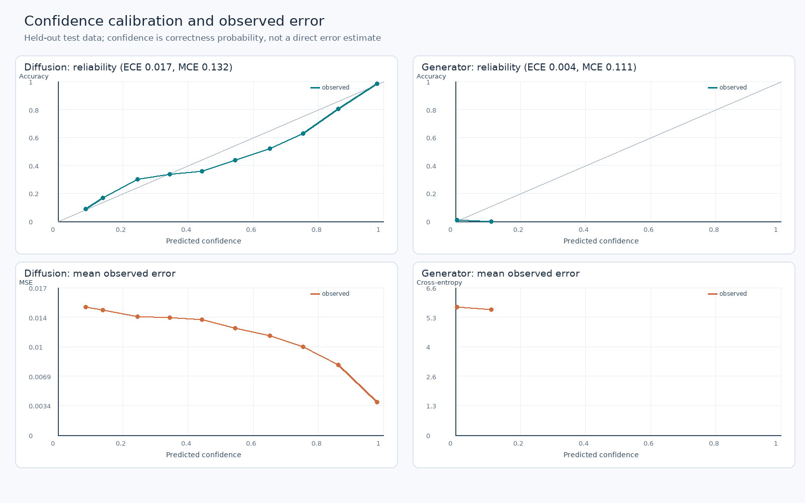
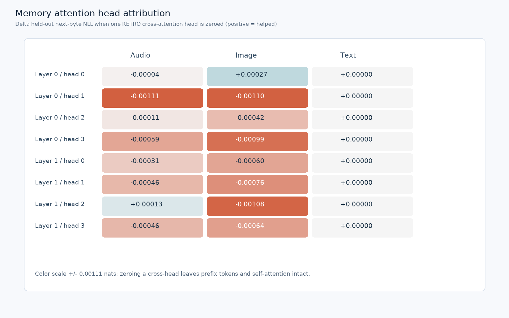
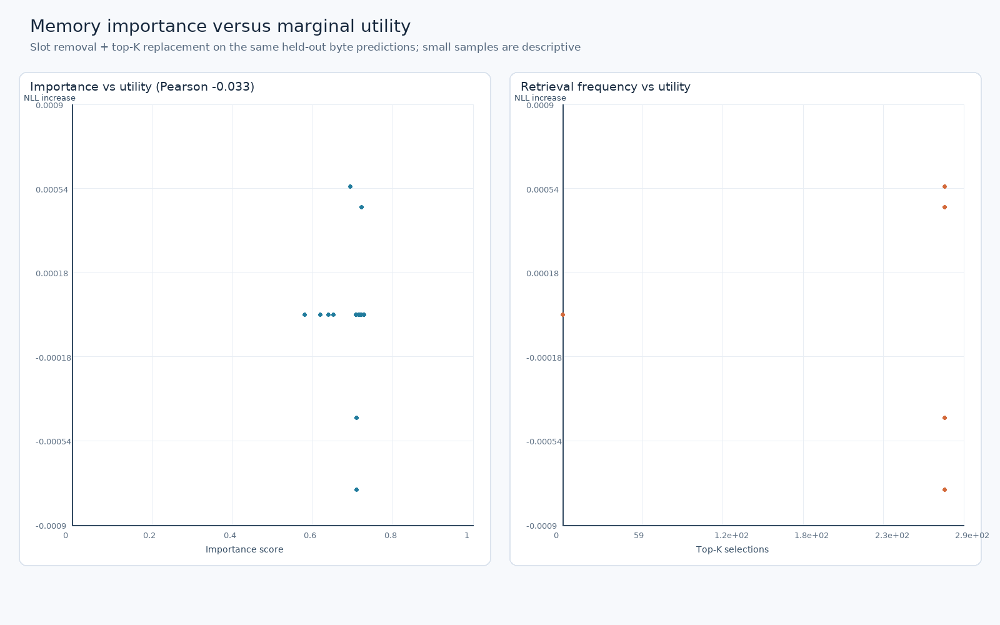
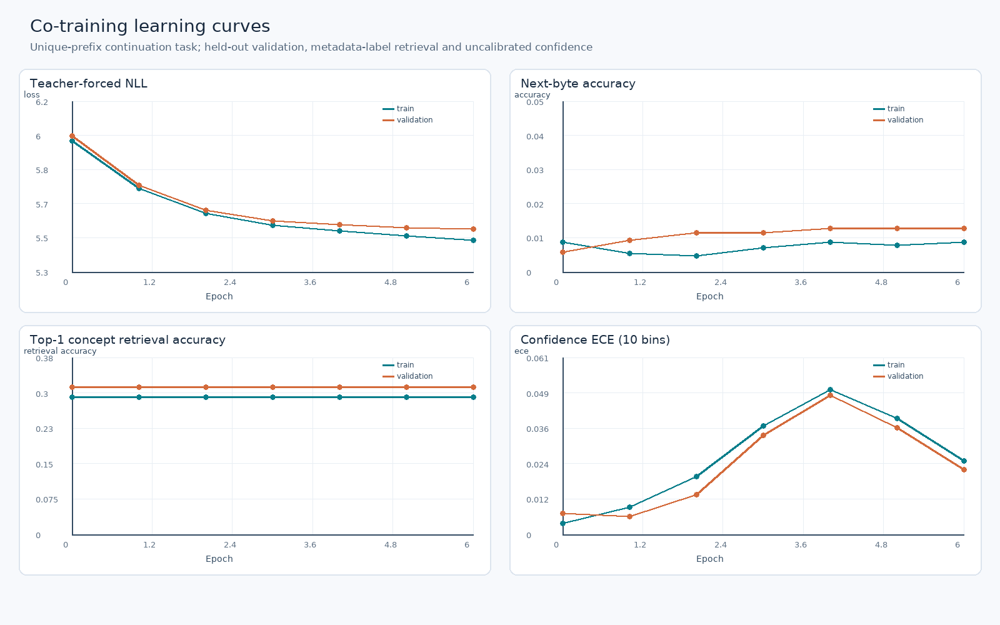

# Phase 5: Full-Spectrum Grounding & Diagnostic Attribution

**Historical report.** Phase 6 replaced the contaminated verification memory, changed the training defaults, and reran evaluation with a fixed (not target-derived) budget. See [Phase 6 report](phase6_report.md).

## Executive summary

- **Calibration is not capability.** On the held-out proxy tasks, 0/6 head/accuracy-target combinations supported a threshold under the independent-example selection criterion. Adaptive halting remains off.
- **Stored replay is not autonomous editing.** 22/22 stored procedures round-tripped, while the trace-trained generator solved 5/10 training excerpts and 0/8 held-out excerpts without a controller.
- **The >70% insertion/deletion recovery target was not reached.** In a matched synthetic retraining experiment, soft-DTW yielded 38.89% insert and 40.13% delete position accuracy. Clean accuracy changed from 99.65% to 98.95%; it regressed.
- **Memory utility is task-dependent.** Removing all memory changed teacher-forced NLL by -0.01604 nats in this checkpoint/test; a negative number means removing it improved NLL.

## Scope and protocol

Text, images and audio remain raw bytes, without external tokenizers. The confidence and diffusion datasets are synthetic; real edits are short, curated before/after excerpts from this repository, not an external benchmark. Model selection and reporting are exploratory and sample sizes are small. Exact output replay returns stored data; it never runs stored bytes as code. NUL remains a valid byte.

## A. Confidence calibration

Temperature fit uses even validation examples, threshold selection uses odd validation examples, and test is separate. Diffusion thresholds use one sequence-level all-bytes-correct observation per sample; generator thresholds use one next-byte observation per sample. Wilson bounds are exploratory and not multiplicity-adjusted. Thresholds do **not** establish THINK or ancestral-sampling reliability.

| Head / scope | Test byte predictions | Correctness | ECE-10 | MCE-10 | 0.90 / 0.95 / 0.99 thresholds |
|---|---:|---:|---:|---:|---|
| diffusion / diffusion_denoising | 92,748 | 69.92% | 0.0171 | 0.1325 | unsupported / unsupported / unsupported |
| generator / next_byte | 90,748 | 1.02% | 0.0042 | 0.1111 | unsupported / unsupported / unsupported |

Per-prediction confidence, actual embedding MSE / cross-entropy, sample ID and noise level are in `calibration_predictions.npz`; calibrated copies are separate from defaults.

## B. Real byte traces

The repository excerpt fixture has 10 train, 4 validation and 8 test examples, separated by source file. The experiment used 80 co-training epochs; held-out outputs were written only after generator evaluation.
- Exact procedure persistence/retrieval: **22/22**. Ordered latent snapshots and explanation bytes were checked.
- Autonomous baseline / trained held-out exact: **0/8** / **0/8**; conditioned on training memory: **0/8**.
- Dynamic programming gives an optimal unit-cost byte Levenshtein trace. MOVE is available to the cognitive loop, but is not a primitive in that optimality claim. Byte insert/replace targets are single-byte actions.
- The historical verification memory was found to contain 12 held-out pairs and was replaced by the guarded train-only runs/phase6/real_traces/memory.pt. Historical replay metrics describe the old verification run, not the replacement checkpoint.
- The historical autonomous budget depended on target-derived edit distance; the Phase 6 rerun uses a fixed budget.

## C. Alignment and recovery

The trained loss is MSE + λ·soft-DTW in embedding space (and optional confidence BCE). Masks exclude padding; soft-DTW is entropy-smoothed and can be negative. Fixed-length denoising cannot itself infer target length or reconstruct information removed by random deletion. The paired arms share initialization, data, noise and seeds; selection was on validation with a 1 percentage-point clean tolerance.

| Checkpoint | Clean | 10% insert, position-wise | 10% delete, position-wise | Insert / delete edit similarity |
|---|---:|---:|---:|---:|
| Original | 99.65% | 38.48% | 38.83% | 84.92% / 83.39% |
| Retrained without alignment | 98.97% | 38.88% | 40.12% | 84.84% / 84.21% |
| Retrained with soft-DTW | 98.95% | 38.89% | 40.13% | 84.86% / 84.20% |

Levenshtein similarity realigns sequences and was already high in the baseline; it is **not** recovery of deleted bytes. No trained alignment checkpoint replaced the original.

## D. Attribution and diagnostics

### Inference ablations

Generator full-memory next-byte accuracy: 0.80%; NLL: 5.7583. Interventions remove one component from the same checkpoint; values are conditional on this task.

| Intervention | Δ NLL (ablated − full) | Δ accuracy |
|---|---:|---:|
| All memory | -0.01604 | +0.00000 |
| Memory layer 0 | -0.01081 | +0.00000 |
| Memory layer 1 | -0.00544 | +0.00000 |
| Episodic tier | +0.00000 | +0.00000 |
| Semantic tier | +0.00000 | +0.00000 |
| Procedural tier | +0.00418 | -0.00066 |

Zeroing each layer's thought-state output (while keeping its hidden output) produced these confidence/cognitive changes:

| Thought layer | Δ ECE | Δ Brier | Synthetic edit exact |
|---|---:|---:|---:|
| 0 | -0.00054 | -0.00000 | 100.00% |
| 1 | +0.00148 | -0.00002 | 100.00% |

On the narrow synthetic edit task, exact success was 100.00% normally, 0.00% when THINK was an identity transition, and 10.16% when READ was an identity transition. These interventions are not general edit benchmarks.
The confidence head's observed ECE/Brier was 0.0006/0.0077; a constant validation prior had 0.0027/0.0080. Requesting confidence changed logits by at most 0; the head by itself does not change output.
Alignment is compared by **retraining**, not falsely treated as an inference-time layer.

### Cross-attention heads

8 RETRO cross-attention heads were individually zeroed at the output projection; self-attention and memory prefix tokens remained active. Text examples are short enough that preceding-chunk retrieval may not activate; zero effects are not evidence that a head is universally irrelevant.

### Memory importance

For 18 selected slots (4 actually retrieved), Pearson/Spearman correlations between importance and paired NLL utility were **-0.033/0.054**. Removing a slot can substitute a different neighbor; many zero effects and the small selected sample prevent broad conclusions.

### Edit operations

The real excerpt counts overlap when optimal traces require multiple edit kinds. Thought confidence was not calibrated for THINK.

| Operation | Synthetic exact | Real test exact | Real mean THINK steps | Real mean thought confidence |
|---|---:|---:|---:|---:|
| insert | 100.00% (n=64) | 0.00% (n=4) | 1.00 | 0.445 |
| delete | 100.00% (n=64) | 0.00% (n=2) | 1.00 | 0.395 |
| replace | 100.00% (n=64) | 0.00% (n=6) | 1.00 | 0.436 |
| move | 100.00% (n=64) | n/a (n=0) | n/a | n/a |

### Learning curves and failures

On a separate unique-prefix continuation experiment, validation NLL changed 6.0094 → 5.5232; accuracy 0.58% → 1.27%; top-1 concept-label retrieval 31.25% → 31.25%; uncalibrated ECE 0.0072 → 0.0222.
Real test edit failure classes: {'wrong_operation': 3, 'wrong_position_payload_or_edit_count': 5}. See [failure_modes.md](failure_modes.md) for separate denominators, high-confidence errors and diffusion shift proxies.

## Recommendations (evidence-based)

1. Keep adaptive halting disabled; gather independently held-out, deployment-matched thought and ancestral trajectories and calibrate each scope after training.
2. Expand real edit data with explicit instructions, more repositories and deduplicated splits; evaluate autonomous execution separately from stored-answer replay and host-controlled traces.
3. Investigate an explicitly length-aware decoder and stronger paired insert/delete supervision; compare against copy/unaligned baselines and require non-regressing clean accuracy before replacing the default.
4. Train and evaluate retrieval against task outcomes, audit tier/router collapse and assess slot utility under realistic queries before tuning importance or eviction.
5. Repeat intervention and calibration studies across seeds, modalities, longer sequences and independent data before claiming causal generality.

## Compatibility, cost and final benchmark

- Included checkpoint parameter counts: diffusion **195,905**, generator **344,408**, memory (capacity 256) **83,565**. Soft-DTW adds **0 learned parameters** and no checkpoint tensors; it adds quadratic sequence-time/memory cost during training.
- The Phase 5 experiment used λ=0.1 and 50% synthetic edit corruption; Phase 6 sets both defaults to zero. This affects future training, not historical checkpoints. Retraining invalidates calibration; optimizers should be recreated when architecture dimensions change.
- Original diffusion final benchmark: clean real-byte reconstruction 99.73%; 10% insertion/deletion position recovery 36.93%/38.12%. See [report.md](report.md).

Artifacts: [calibration metrics](calibration.json), [real traces](real_traces/metrics.json), [alignment experiment](alignment/metrics.json), [ablations](ablation.json), [head results](head_attribution.json), [importance results](importance_validation.json), [edit results](edit_operation_analysis.json), [learning metrics](learning_curve.json), [failure analysis](failure_modes.md).
- Verification: 56 unit tests passed (2.664 s); compileall, git diff --check, tokenizer-import check, calibration checkpoint reload, trace ingestion CLI, and isolated alignment-training smoke passed.
