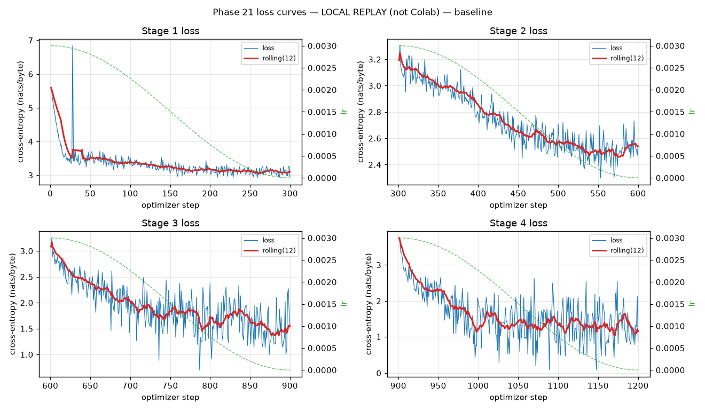
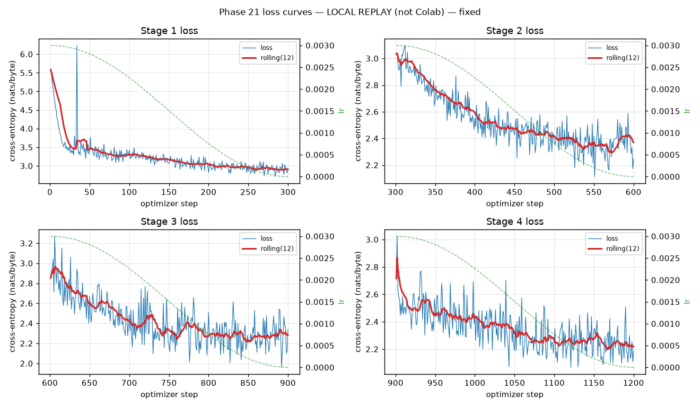

# 21.1 — Training log autopsy

**Log source:** `LOCAL REPLAY — deterministic CPU re-run of the Phase 19 pipeline, NOT the Colab logs: baseline_metrics.jsonl, fixed_metrics.jsonl`

Phase 19 Colab artifacts are gitignored (.gitignore: data_cache/, checkpoints/, final_model/, final_model_fp16.pt). They live only in the ephemeral Colab runtime and are NOT in this checkout. Any conclusion about the 4-hour run must be derived from source forensics plus a deterministic local replay, or from artifacts the user re-uploads.

## Per-stage loss

| stage | steps | first | last | mean | min | max |
| --- | --- | --- | --- | --- | --- | --- |
| 1 | 300 | 5.58932 | 2.94721 | 3.32916 | 2.92041 | 6.83897 |
| 2 | 300 | 3.19377 | 2.5436 | 2.72816 | 2.29974 | 3.30321 |
| 3 | 300 | 3.08283 | 1.58071 | 1.91486 | 0.69872 | 3.25129 |
| 4 | 300 | 3.74769 | 0.8859 | 1.60506 | 0.08252 | 3.74769 |

## Detector results

| question | result | evidence |
| --- | --- | --- |
| Loss spike (gradient explosion)? | False | 0 spikes > 3x rolling median |
| Loss collapsed to near zero too fast? | False | 0 stages reached < 0.05 |
| NaN / Inf values? | False | 0 records |
| LR scheduling failed? | False | 4 stages with lr data |
| Catastrophic forgetting? | True | no eval records |
| Gradient norms logged? | True | These are the norms returned by clip_grad_norm_ BEFORE clipping. notebook.train clips the global norm to 1.0 before every AdamW step, so isolated large norms never reach the weights. A few early spikes are normal initialisation, not explosion. |
| Encoding corruption visible? | not testable from loss | Token/byte encoding corruption cannot be detected from loss curves; see debug/test_byte_encoding.py and debug/verify_training_data.py. A clean loss curve is fully compatible with a broken decode path. |

## Per-variant comparison

| variant | spikes | NaN/Inf | LR failed | forgetting | worst held-out PT stage | worst/first ratio |
| --- | --- | --- | --- | --- | --- | --- |
| baseline | False | False | False | True | 3 | 1.53 |
| fixed | False | False | False | False | 1 | 1.0 |

### baseline loss curves

### fixed loss curves

