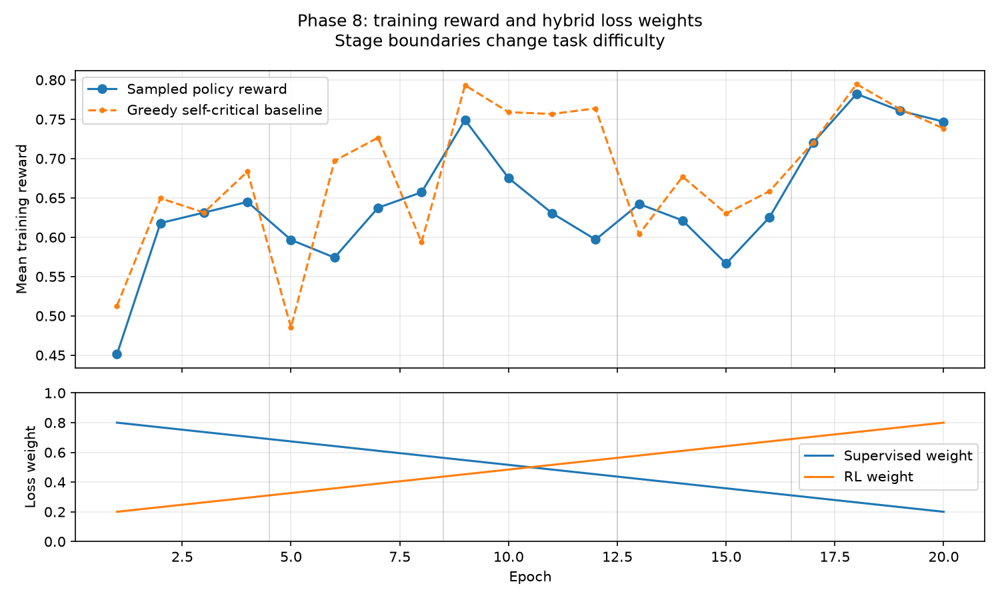

# Phase 8 — reasoning supervision and autonomous editing

## Outcome

- **Final-epoch real held-out exact success: 0/8 (0.0%).** The requested >4/8 target was not met.
- Pretraining baseline: **0/8 (0.0%)**; validation-selected final-stage checkpoint (epoch 17): **0/8 (0.0%)**.
- The selected checkpoint scored **0/4 (0.0%)** on the four real validation records and **0/10 (0.0%)** on a separate, explicitly instructed synthetic curriculum validation set. Synthetic scores are not real-edit performance.
- Mean test byte-edit similarity: baseline 0.703, selected 0.732, final epoch 0.643. On real validation the selected policy completed 50% of episodes; the rest hit the fixed action cap. Similarity and completion are not exact success.

The real fixture's provenance explanations are not actionable edit requests. The same source can have many valid changes, so its target cannot generally be inferred from source bytes alone. The source-file split and byte guards establish only the stated separation; they cannot certify that pre-existing model weights have never encountered semantically equivalent text.

## Protocol and safeguards

- Training: 40 generated train examples across five stages, plus 10 real training pairs sampled as 2 anchors per epoch; 20 epochs, seed 881, learning rate 0.0003, rollout temperature 0.8.
- Train-only traces provide supervised labels; sampled policy rollouts use no memory, controller, or stored trace. Registered holdouts included the 4 real validation, 8 real test, 10 curriculum validation, and 1000 pre-existing processed synthetic records. Raw inputs, targets, instructions, trace payloads and intermediate canvases are checked before training; the guard is not a model-weight or semantic-leakage detector.
- Training rollout budget 16; all real validation/test inference uses a fixed 128-action budget. The target is accessed only after generation for scoring. The real held-outs use no memory, initial trace, controller, oracle action or instruction text.
- Validation selection, fixed before test evaluation, considers only final-stage epochs, maximizing validation exact success and then normalized byte similarity, with earliest epoch winning ties. Baseline, selected and final-epoch policies are all evaluated after selection; the test does not select weights.
- Generator: 352,728 parameters including 8,320 in the new head; 105,871 parameter tensor elements participate in this selective fine-tuning (legacy head/control rows are gradient-masked).

## Objectives and caveats

A fixed, order-sensitive raw-byte sketch of the target minus the current document supervises the post-THINK mean scratchpad via Linear–SiLU–Linear MSE. The label is detached and used only during training. The sketch is lossy and can collide; it does not prove symbolic reasoning.

Training reward is `1 - byte_levenshtein(committed_canvas,target)/max(len(committed_canvas),len(target),1) - 0.01*(THINK steps + EDIT actions)`. The policy-gradient term uses `-(reward − greedy_baseline) × log_probability(sampled_action_sequence)`, where the baseline depends on the current training example but not the sampled action. Masked control, pointer, kind, byte and destination-remapping probabilities are differentiably replayed. The objective adds `0.5 × reasoning_MSE` to the supervised/RL mixture, with gradient clipping. Sampling and replay share the same attention path; the process-global PyTorch fast-path setting is restored afterward.

This reward can prefer an unchanged long document over a correct small edit because THINK and EDIT carry a fixed cost. A high similarity reward is not an exact success. Across the curve, each stage has different examples and difficulty, so epoch rewards are not a controlled learning curve.

## Training reward curve



| Epoch | Curriculum stage | Supervised / RL | Sample reward | Greedy baseline | Sample exact | Reasoning MSE | Real validation exact |
|---:|---|---:|---:|---:|---:|---:|---:|
| 1 | single_byte_substitution | 0.800 / 0.200 | 0.4511 | 0.5129 | 10.0% | 0.00013 | 0/4 |
| 2 | single_byte_substitution | 0.768 / 0.232 | 0.6180 | 0.6495 | 20.0% | 0.00009 | 0/4 |
| 3 | single_byte_substitution | 0.737 / 0.263 | 0.6313 | 0.6313 | 10.0% | 0.00010 | 0/4 |
| 4 | single_byte_substitution | 0.705 / 0.295 | 0.6449 | 0.6835 | 10.0% | 0.00010 | 0/4 |
| 5 | single_word_replacement | 0.674 / 0.326 | 0.5967 | 0.4853 | 0.0% | 0.00022 | 0/4 |
| 6 | single_word_replacement | 0.642 / 0.358 | 0.5741 | 0.6971 | 0.0% | 0.00005 | 0/4 |
| 7 | single_word_replacement | 0.611 / 0.389 | 0.6374 | 0.7265 | 20.0% | 0.00005 | 0/4 |
| 8 | single_word_replacement | 0.579 / 0.421 | 0.6571 | 0.5936 | 0.0% | 0.00006 | 0/4 |
| 9 | single_line_edit | 0.547 / 0.453 | 0.7491 | 0.7931 | 0.0% | 0.00008 | 0/4 |
| 10 | single_line_edit | 0.516 / 0.484 | 0.6752 | 0.7590 | 0.0% | 0.00013 | 0/4 |
| 11 | single_line_edit | 0.484 / 0.516 | 0.6305 | 0.7567 | 10.0% | 0.00001 | 0/4 |
| 12 | single_line_edit | 0.453 / 0.547 | 0.5970 | 0.7638 | 10.0% | 0.00013 | 0/4 |
| 13 | multiline_insert_delete | 0.421 / 0.579 | 0.6423 | 0.6038 | 0.0% | 0.00127 | 0/4 |
| 14 | multiline_insert_delete | 0.389 / 0.611 | 0.6213 | 0.6770 | 0.0% | 0.00126 | 0/4 |
| 15 | multiline_insert_delete | 0.358 / 0.642 | 0.5664 | 0.6300 | 0.0% | 0.00121 | 0/4 |
| 16 | multiline_insert_delete | 0.326 / 0.674 | 0.6255 | 0.6586 | 10.0% | 0.00096 | 0/4 |
| 17 | code_block_move | 0.295 / 0.705 | 0.7203 | 0.7204 | 0.0% | 0.00015 | 0/4 |
| 18 | code_block_move | 0.263 / 0.737 | 0.7822 | 0.7946 | 0.0% | 0.00012 | 0/4 |
| 19 | code_block_move | 0.232 / 0.768 | 0.7607 | 0.7628 | 0.0% | 0.00007 | 0/4 |
| 20 | code_block_move | 0.200 / 0.800 | 0.7469 | 0.7382 | 10.0% | 0.00013 | 0/4 |

## Reasoning-head diagnostic (training examples only)

For teacher-forced post-THINK states, compare each checkpoint's MSE with predicting an all-zero intent. These are training-set diagnostics, not generalization results; the very small zero-vector loss for line edits and moves reveals that this sketch can provide a weak learning signal.

| Training stage | Examples | Zero-vector MSE | Selected MSE | Final-epoch MSE |
|---|---:|---:|---:|---:|
| single_byte_substitution | 8 | 0.000135 | 0.000397 | 0.000218 |
| single_word_replacement | 8 | 1.04e-05 | 5.73e-05 | 1.33e-05 |
| single_line_edit | 8 | 3.99e-08 | 2.29e-05 | 1.67e-05 |
| multiline_insert_delete | 8 | 0.0015 | 0.000923 | 0.00137 |
| code_block_move | 8 | 1.69e-07 | 8.05e-05 | 2.55e-06 |
| real_train | 10 | 0.000301 | 0.000397 | 0.000259 |

The selected head is worse than the zero predictor in 5/6 training groups. The MSE implementation has verified gradients; this comparison alone cannot establish useful edit intent or generalization.

## Eight real held-out tasks: final epoch

| ID | Exact | Done | Actions | Byte distance | Reward |
|---|---:|---:|---:|---:|---:|
| test-code-01 | no | yes | 5 | 19 | 0.1883 |
| test-code-02 | no | yes | 6 | 3 | 0.7825 |
| test-code-03 | no | yes | 6 | 4 | 0.7347 |
| test-code-04 | no | yes | 5 | 4 | 0.7300 |
| test-code-05 | no | yes | 5 | 2 | 0.8467 |
| test-code-06 | no | yes | 5 | 3 | 0.8133 |
| test-text-01 | no | yes | 5 | 7 | 0.4800 |
| test-text-02 | no | yes | 5 | 46 | 0.3903 |

## Reproduction and artifacts

```bash
.venv/bin/python data/generate.py  # recreate the ignored holdout registry
.venv/bin/python -m training.rl_editing --epochs 20 --examples-per-stage 8 --real-anchors 2 \
  --rollout-budget 16 --eval-budget 128 --temperature 0.8 --lr 0.0003 --seed 881 --threads 1
.venv/bin/python -m evaluation.phase8_reasoning
.venv/bin/python -m evaluation.phase8_report
```

`runs/phase8/metrics.json` contains the full curve, per-example outputs and action records; `runs/phase8/generator.pt` is the validation-selected final-stage checkpoint and `runs/phase8/last_epoch.pt` is the final-epoch checkpoint. Reproducing results requires the original train-only generator checkpoint and the same dependency versions.

The checkout used here contained Phase 6 artifacts but no independently verifiable Phase 7 mask-conditioning implementation. No Phase 7 success is assumed or claimed.

## Verification

85/85 tests passed. A guarded five-stage co-training smoke passed, the existing guarded memory audit found zero failed slots, and frozen backbone/legacy rows matched the starting checkpoint. Compilation, whitespace, tokenizer-import, checkpoint-migration and policy-gradient checks passed. See `runs/phase8/verification.json` for versions and checkpoint hashes.
